<div align="center">

<a href="https://the-turning-wheel.vercel.app"></a>

# The Turning Wheel

**Premium imported crockery and kitchenware, priced below Amazon and Nestasia.**<br />
A one-page catalog where customers browse, fill a cart, and send the whole order to the seller on WhatsApp.

[**Visit the live site →**](https://the-turning-wheel.vercel.app)

[](#tech-stack)
[](#run-it-locally)
[](#deployment)
[](#cart-and-whatsapp-checkout)
[](#catalog-at-a-glance)

</div>

---

## Contents

- [About](#about)
- [See it in action](#see-it-in-action)
- [Catalog at a glance](#catalog-at-a-glance)
- [Features](#features)
- [Screenshots](#screenshots)
- [How it works](#how-it-works)
- [Project structure](#project-structure)
- [Tech stack](#tech-stack)
- [Run it locally](#run-it-locally)
- [Managing the catalog](#managing-the-catalog)
- [Deployment](#deployment)
- [Accessibility and browser support](#accessibility-and-browser-support)
- [Team](#team)
- [License](#license)

## About

**The Turning Wheel** is a small business that sells hand-picked, imported crockery and kitchenware: printed bowl sets, novelty mugs, mandala serveware, statement trays and a silicone baby range. This repository is its storefront.

The site is a single static page. It lists the 2026 catalog of **17 products in 5 categories**, shows every item's price next to its Amazon or Nestasia listing so the saving is obvious, and turns the customer's cart into a ready-to-send WhatsApp message. The seller then confirms stock, price and delivery in the chat. There is no backend, no database, no payment gateway and no build step: three hand-written files, a folder of photos, and Vercel to serve them.

**Design goals**

| Goal | How the site meets it |
|---|---|
| Zero infrastructure | Plain `index.html`, `styles.css` and `app.js`, served as static files. Nothing to install, build or keep running. |
| Transparent pricing | Every card carries a frosted-glass price card: the marketplace price struck through, our price, and a `SAVE n%` tag calculated from the two. |
| Ordering without friction | Customers never type product names, quantities or totals. The cart writes the WhatsApp message for them. |
| Easy to maintain | Products live in one array. Photos are discovered automatically from numbered files, so adding a picture needs no code change. |
| Built for phones | Swipeable photo carousels, a slide-in cart, a full-screen menu and one tap to WhatsApp. |

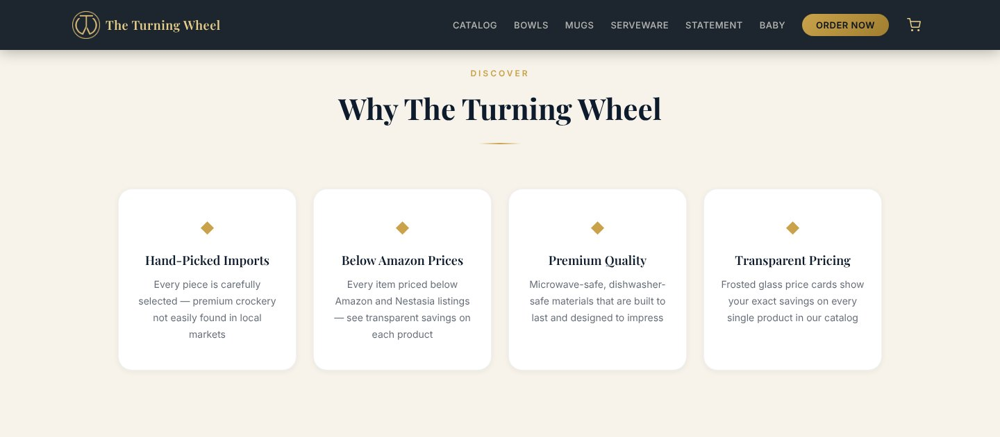

## See it in action

Filter to a category, swipe through a product's photos, add items, adjust a quantity and open the cart:

<p align="center">
  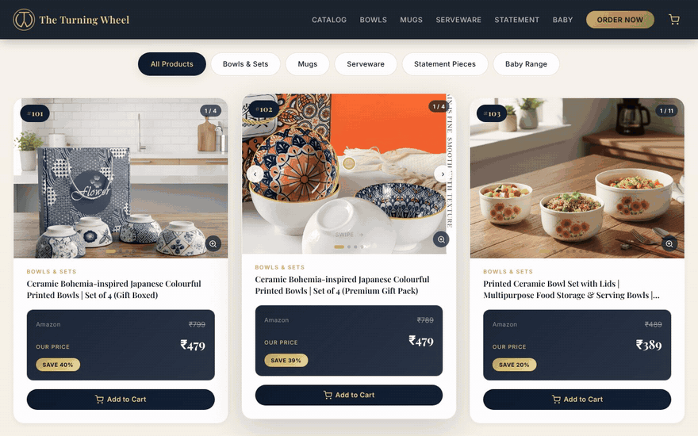
</p>

## Catalog at a glance

Every figure below is calculated from the `PRODUCTS` array in [`app.js`](app.js), the same data the site renders.

<picture>
  <source media="(prefers-color-scheme: dark)" srcset="docs/readme/charts/catalog-kpis-dark.svg" />
  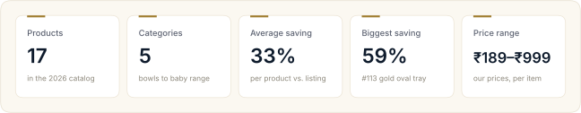
</picture>

Buying one of every item costs **₹7,964** here, against **₹12,674** at the listed marketplace prices: **₹4,710 (37%) less**.

<picture>
  <source media="(prefers-color-scheme: dark)" srcset="docs/readme/charts/price-comparison-dark.svg" />
  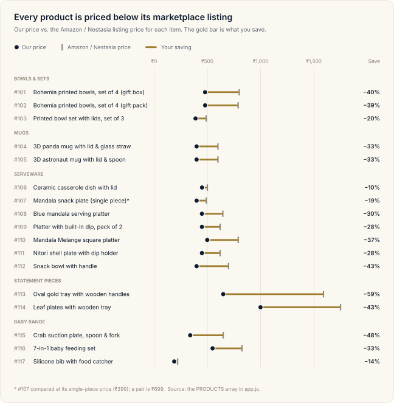
</picture>

<picture>
  <source media="(prefers-color-scheme: dark)" srcset="docs/readme/charts/category-mix-dark.svg" />
  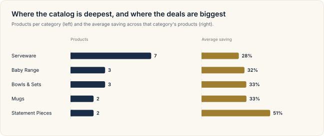
</picture>

<details>
<summary><b>Full catalog table</b> (17 products)</summary>
<br />

| # | Product | Category | Compared with | Listing price | Our price | Saving |
|---:|---|---|---|---:|---:|---:|
| 101 | Ceramic Bohemia-inspired Japanese Colourful Printed Bowls \| Set of 4 (Gift Boxed) | Bowls & Sets | Amazon | ₹799 | ₹479 | 40% |
| 102 | Ceramic Bohemia-inspired Japanese Colourful Printed Bowls \| Set of 4 (Premium Gift Pack) | Bowls & Sets | Amazon | ₹789 | ₹479 | 39% |
| 103 | Printed Ceramic Bowl Set with Lids \| Multipurpose Food Storage & Serving Bowls \| Microwave & Dishwasher Safe (Set of 3, Multisize) | Bowls & Sets | Amazon | ₹489 | ₹389 | 20% |
| 104 | Cute 3D Panda Coffee Mug with Lid and Glass Straw — Ceramic Kawaii Panda Cup with Handle | Mugs Collection | Amazon | ₹599 | ₹399 | 33% |
| 105 | 3D Astronaut Ceramic Mug with Lid and Spoon \| Planet Coffee Mug (400ml, Blue) | Mugs Collection | Amazon | ₹599 | ₹399 | 33% |
| 106 | Ceramic Casserole Dish with Lid \| Oven Safe, Heat Resistant Cookware | Serveware | Amazon | ₹500 | ₹450 | 10% |
| 107 | Mandala Ceramic Snack Plates (Blue & Yellow) \| Square Dessert Plates with Handle (8.6 Inch) | Serveware | Nestasia | ₹490 | ₹399 (1 piece) / ₹699 (2 piece) | 19%¹ |
| 108 | Ceramic Serving Platter with Handles \| Blue Mandala Print (10.8 Inch) | Serveware | Amazon | ₹645 | ₹449 | 30% |
| 109 | Serving Platter with Built-in Dip \| Snack Sushi Appetizer Tray for Momos & Nachos (Pack of 2) | Serveware | Amazon | ₹620 | ₹449 | 28% |
| 110 | Mandala Melange Ceramic Serving Platter \| Square Shape | Serveware | Nestasia | ₹790 | ₹499 | 37% |
| 111 | Nitori Shell Serving Plate with Built-in Dip Holder \| Snack Sushi Appetizer Tray | Serveware | Amazon | ₹620 | ₹449 | 28% |
| 112 | Ceramic Snack Bowl with Handle \| White & Blue \| Microwave & Dishwasher Safe | Serveware | Amazon | ₹699 | ₹399 | 43% |
| 113 | Oval Metal Tray with Wooden Handle \| Gold (13 x 8 Inch) | Statement Pieces | Nestasia | ₹1,590 | ₹649 | 59% |
| 114 | Ceramic Serving Platter \| 4 Small Leaf-Shaped Plates with 1 Wooden Tray (Blue & White) | Statement Pieces | Amazon | ₹1,750 | ₹999 | 43% |
| 115 | Crab Silicone Suction Plate with Spoon and Fork Set \| BPA-Free \| 6+ Months | Baby Range | Amazon | ₹649 | ₹339 | 48% |
| 116 | 7-in-1 Silicone Baby Feeding Set \| BPA-Free, Microwave Safe \| Suction Plate, Bowl, Spoon, Fork, Cup & Bib | Baby Range | Amazon | ₹825 | ₹549 | 33% |
| 117 | Silicone Baby Bib with Food Catcher \| Adjustable Neck, BPA-Free (6 Months–5 Years) | Baby Range | Amazon | ₹221 | ₹189 | 14% |

¹ #107 has two price options. Its saving, like the `SAVE` tag on the site, is calculated from the single-piece price.

Listing prices are the Amazon and Nestasia prices recorded in the catalog data. Marketplace prices change over time.

</details>

## Features

### Browsing the catalog

- **Category filters.** All Products, Bowls & Sets, Mugs, Serveware, Statement Pieces and Baby Range. The Bowls, Mugs, Serveware, Statement and Baby links in the navigation apply the same filter and scroll down to the catalog.
- **Product cards.** A `#101`-style number badge, a photo carousel, the category, the title, and the price card with the marketplace price, our price and the saving.
- **Photo carousels.** Swipe on touch screens, drag with a mouse, or use the arrows and dots. CSS scroll-snap keeps each photo centred, a `1 / 6` counter shows the position, and a "Swipe →" hint disappears after the first interaction.
- **Product details modal.** Clicking a card opens a larger carousel with the full title, the price card, Add to Cart, and a **Quick Order (this item only)** button that opens WhatsApp with a message about that one product.
- **Full-screen photo viewer.** The magnifier button on any photo opens the uncropped image: scroll or pinch to zoom up to 5×, drag to pan, double-click or double-tap to toggle zoom, and swipe, click the arrows or press <kbd>←</kbd> <kbd>→</kbd> to move between photos. <kbd>Esc</kbd> closes it.

### Cart and WhatsApp checkout

- **Add to Cart becomes a quantity stepper.** After the first tap, the button slides into a `− n +` control. The product's card, its modal and the cart drawer always show the same quantity.
- **Cart badge and toast.** The cart icon in the navigation shows the number of items, and a short toast confirms each Add to Cart tap.
- **Slide-in cart drawer.** Line items with per-line totals, quantity controls, Remove, and an estimated total. An item with option-based pricing (such as #107) is listed with its price note, and the total is marked `+`.
- **Customer details.** Name and phone are required and the address is optional. They are remembered on the customer's device for next time.
- **One-tap order.** *Place Order on WhatsApp* checks the cart and details, then opens `wa.me` with the whole order written out.
- **Nothing leaves the device until the customer sends it.** The cart and details are kept in `localStorage` (`ttw_cart_v1` and `ttw_customer_v1`), so they survive a reload. No server receives them.

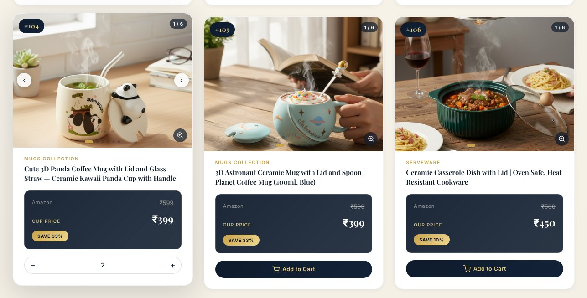

This is the exact message the site generates for a cart holding two panda mugs, one mandala snack plate and the gold tray:

```text
Hi! I'd like to place an order from The Turning Wheel catalog.

Order:
#104 - Cute 3D Panda Coffee Mug with Lid and Glass Straw — Ceramic Kawaii Panda Cup with Handle x2 = ₹798
#107 - Mandala Ceramic Snack Plates (Blue & Yellow) | Square Dessert Plates with Handle (8.6 Inch) x1 (₹399 (1 piece) / ₹699 (2 piece))
#113 - Oval Metal Tray with Wooden Handle | Gold (13 x 8 Inch) x1 = ₹649

Estimated Total: ₹1447 + item(s) with custom pricing above

Name: Customer Name
Phone: 98XXXXXXXX
Delivery Address: Flat 4B, Example Street, City
```

### Look and feel

- **Navy, gold and ivory.** Playfair Display for headings and prices, Inter for everything else (see [design tokens](#change-the-look)).
- **Animated hero.** 30 drifting gold particles, statistics that count up when they scroll into view, and a bouncing scroll cue.
- **Motion with restraint.** Cards lift on hover and fade up as they scroll into view, and the cart, modal and mobile menu slide in with eased transitions.
- **Responsive layout.** The "Why" grid steps from 4 columns to 2 to 1. The product grid fills as many columns of at least 340 px as fit, and becomes a single column on phones. Below 768 px the links move into a slide-in menu.

### Low maintenance

- **One array of products.** Prices, titles and categories are edited in `PRODUCTS`, and the `SAVE n%` tags are calculated automatically.
- **Photos are discovered, not configured.** Drop `1.jpg`, `2.jpg`, … into `images/<product number>/` and the carousel picks up the count, up to 20 per product.
- **Helpful placeholders.** Until a product has photos, its carousel shows striped placeholder slides in the category's colours, labelled *"Product 104 — Image 1 · Drag your product photo here"*.

## Screenshots

<table>
  <tr>
    <td width="50%">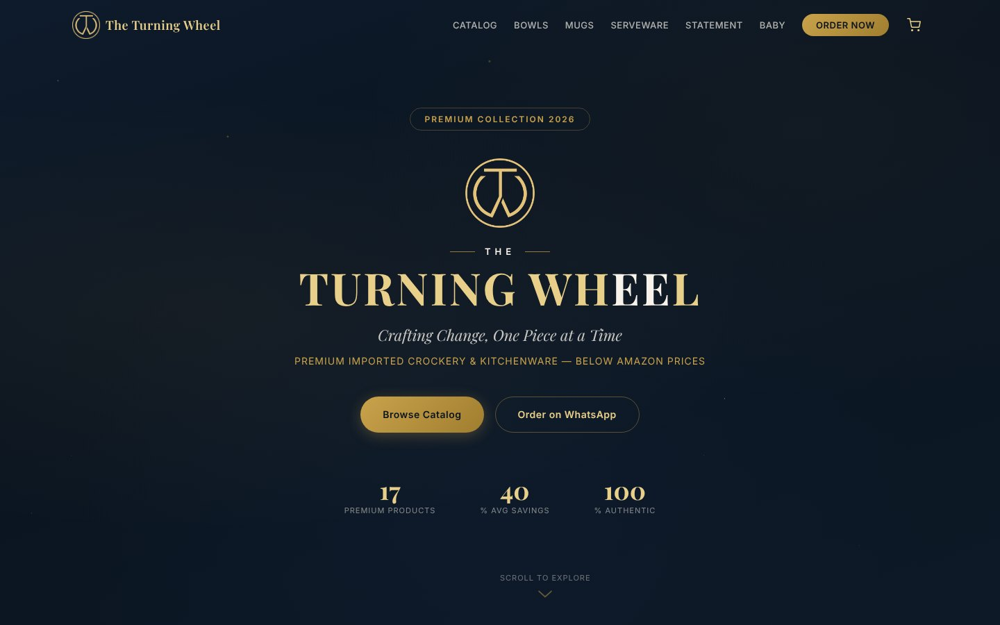</td>
    <td width="50%">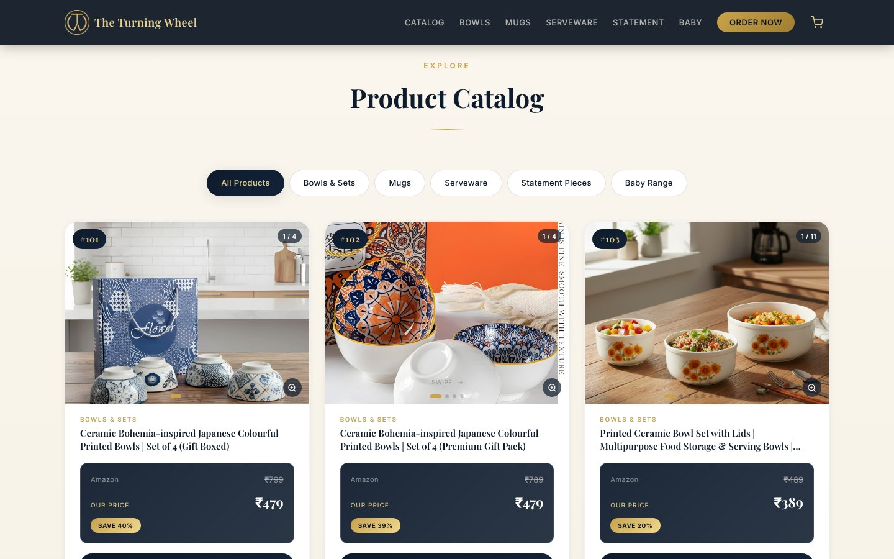</td>
  </tr>
  <tr>
    <td align="center"><b>Home</b>: tagline, calls to action and animated counters</td>
    <td align="center"><b>Catalog</b>: category filters and price cards</td>
  </tr>
  <tr>
    <td width="50%">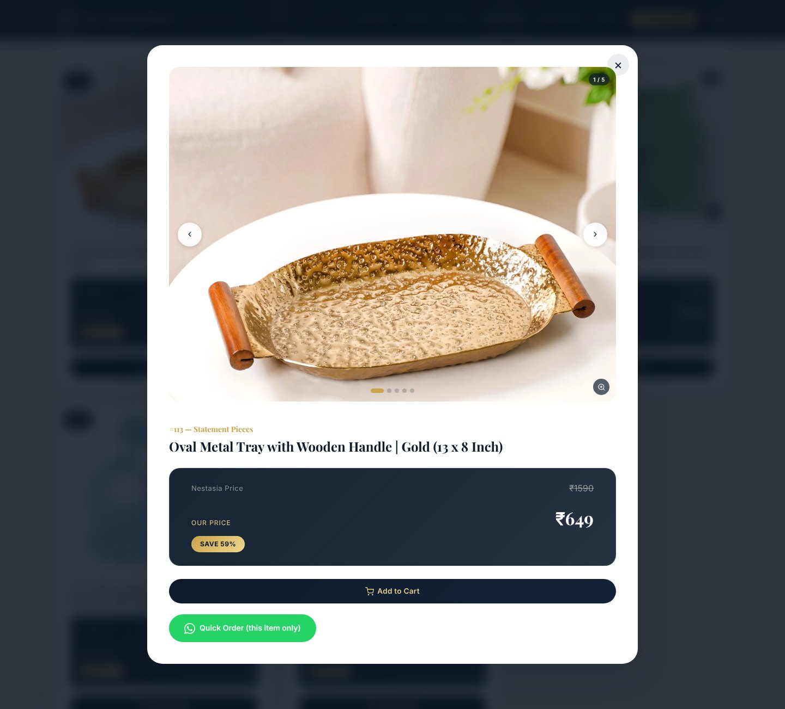</td>
    <td width="50%">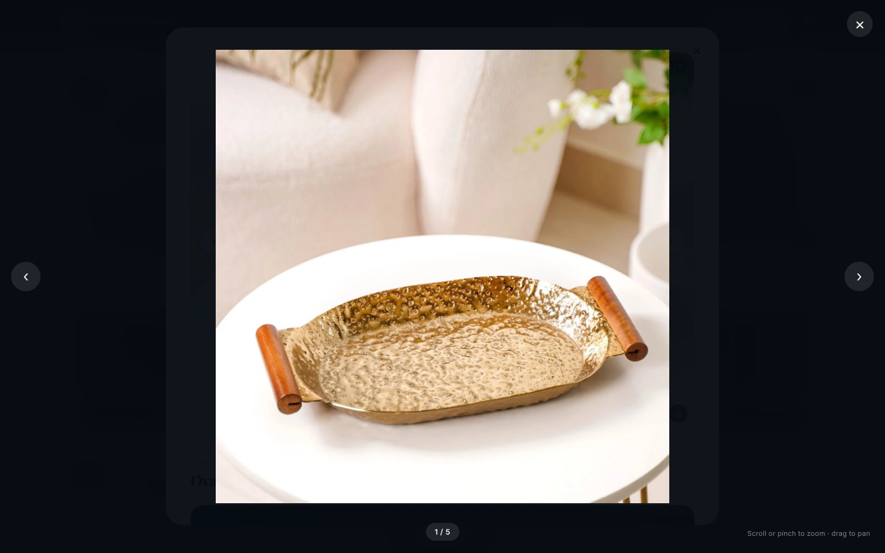</td>
  </tr>
  <tr>
    <td align="center"><b>Product details</b>: large carousel, Add to Cart and Quick Order</td>
    <td align="center"><b>Photo viewer</b>: zoom, pan and swipe through photos</td>
  </tr>
  <tr>
    <td width="50%"></td>
    <td width="50%">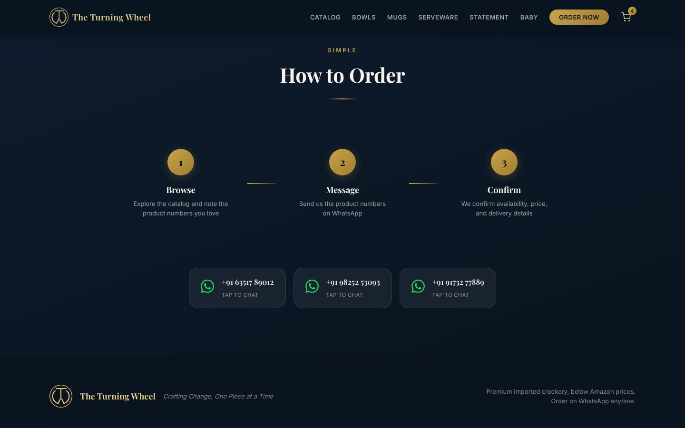</td>
  </tr>
  <tr>
    <td align="center"><b>Cart drawer</b>: quantities, details and one-tap WhatsApp order</td>
    <td align="center"><b>How to order</b>: three steps and WhatsApp contacts</td>
  </tr>
</table>

**On a phone**

<table>
  <tr>
    <td width="25%">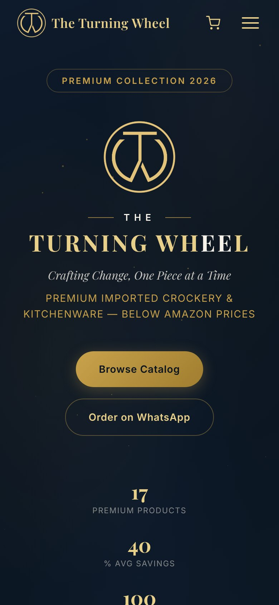</td>
    <td width="25%">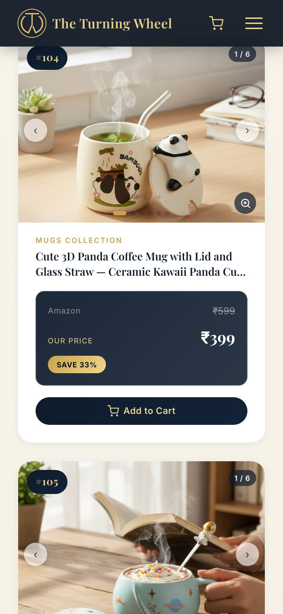</td>
    <td width="25%">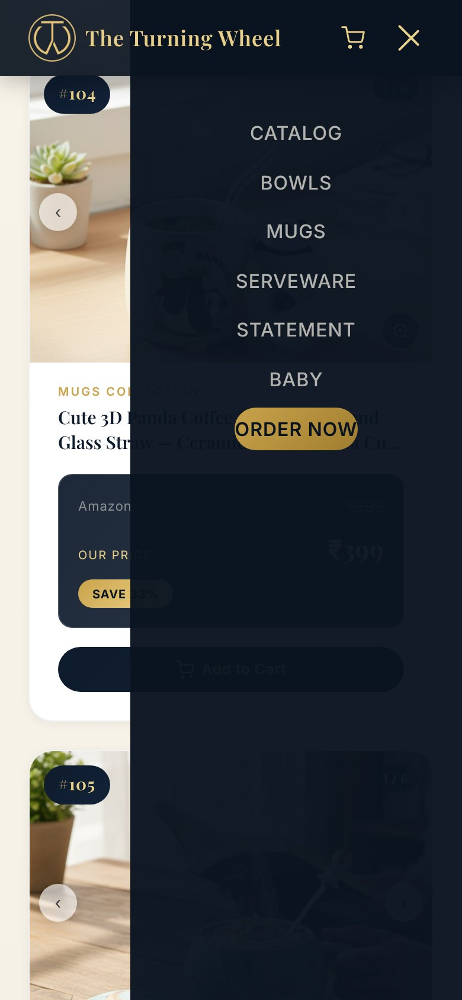</td>
    <td width="25%">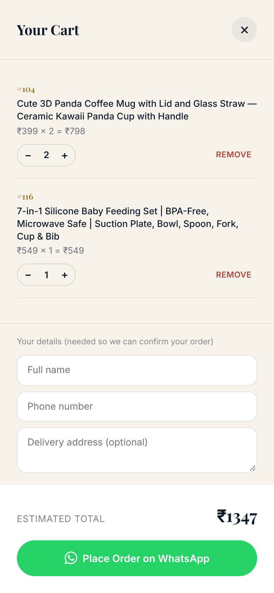</td>
  </tr>
  <tr>
    <td align="center">Home</td>
    <td align="center">Product card</td>
    <td align="center">Menu</td>
    <td align="center">Cart</td>
  </tr>
</table>

## How it works

### Architecture

There is no server-side code. Vercel serves the files as they are, and everything else happens in the customer's browser: `app.js` renders the catalog from its own data, `localStorage` holds the cart, and the order is handed to WhatsApp as a pre-filled message.

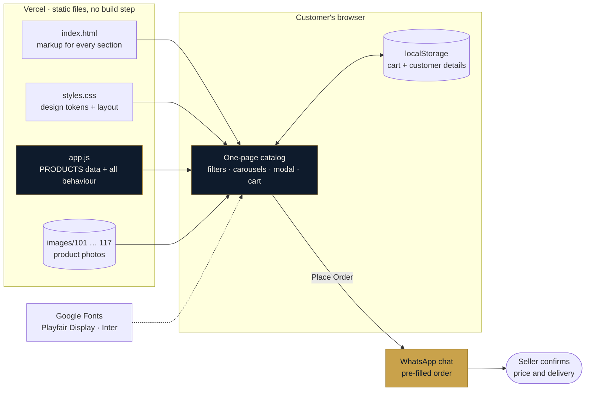

Vercel Web Analytics is loaded from `/_vercel/insights/script.js` in the page `<head>` and records page views.

### What happens when the page loads

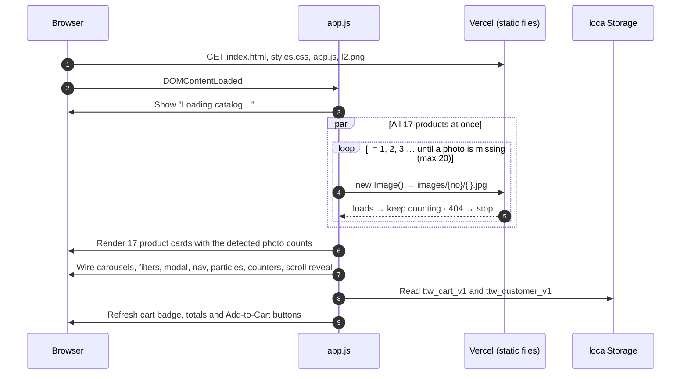

Photo detection runs for all products in parallel, but within a product it checks `1.jpg`, `2.jpg`, … one at a time, and each check downloads the photo. The catalog appears once the slowest product has finished, so [smaller photo files](#add-photos) make the first load noticeably faster.

### From cart to WhatsApp order

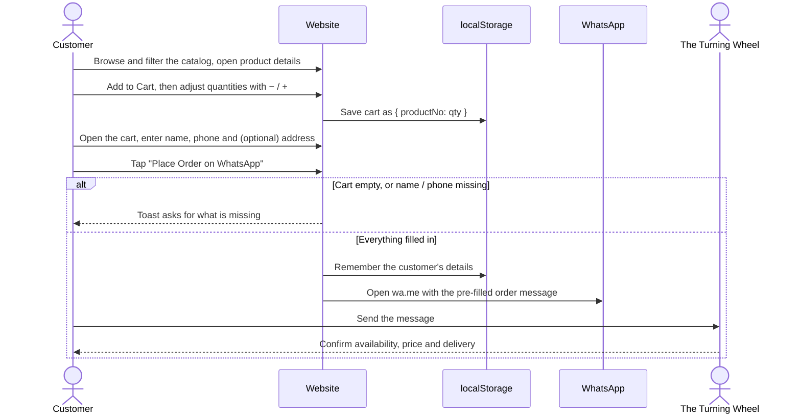

### The Add to Cart control

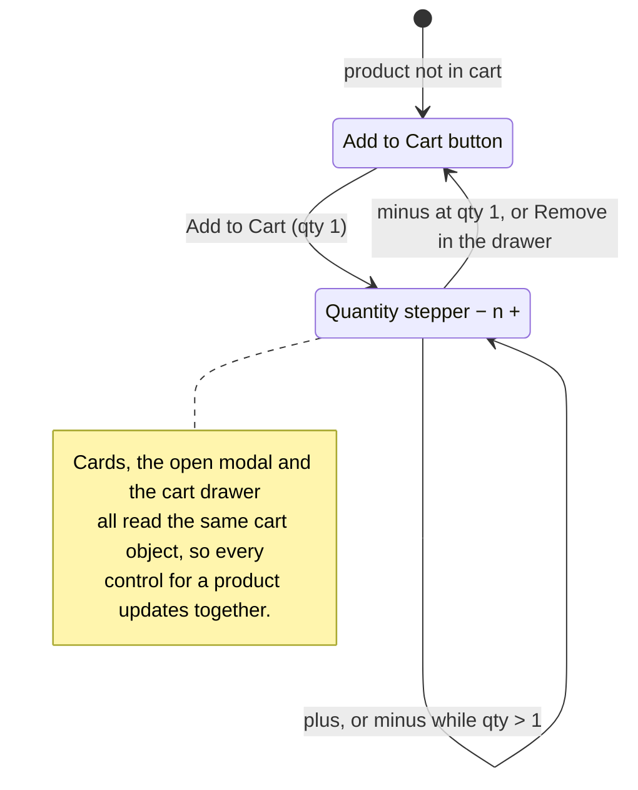

### Code map

`app.js` is organised into small `init*` functions that each own one part of the page:

| Area | Functions and constants | What they do |
|---|---|---|
| Data | `PRODUCTS`, `CATEGORY_COLORS` | Catalog entries, and the placeholder colours for each category |
| Rendering | `renderProductCard`, `renderModal`, `initProductsGrid` | Build card and modal HTML, including the price card and `SAVE n%` tag |
| Photos | `probeImageExists`, `detectPhotoCount`, `detectAllPhotoCounts`, `MAX_PHOTOS_PER_PRODUCT` | Count each product's numbered photos before the grid renders |
| Carousels | `initCarousels(scope)` | Arrows, dots, touch swipe, mouse drag and scroll-snap sync. Binds each track once, and the modal passes only its own scope |
| Filters and navigation | `initFilters`, `initCategoryNavLinks`, `initNav`, `initSmoothScroll` | Category filtering, nav links that filter, the sticky nav and mobile menu, smooth anchor scrolling |
| Modal and photo viewer | `initModal`, `initLightbox` | Product details; full-screen zoom, pan and swipe viewer |
| Hero effects | `initParticles`, `initCounters`, `initScrollReveal` | Floating particles, count-up statistics, fade-up reveals |
| Cart and checkout | `loadCart`, `saveCart`, `addToCart`, `updateCartQty`, `removeFromCart`, `computeCartTotal`, `renderCartItems`, `refreshCartUI`, `syncCartControls`, `buildWhatsappOrderMessage`, `showToast`, `initCart` | Cart state and persistence, the drawer, validation, and the WhatsApp message |

And `index.html` is one page made of these blocks:

| Block | Element | Purpose |
|---|---|---|
| Navigation | `nav#nav` | Logo, category links, Order Now, cart button with badge, mobile menu toggle |
| Hero | `section#hero` | Badge, logo, title, tagline, two calls to action, counters |
| Why | `section#why` | Four value propositions |
| Catalog | `section#catalog` | Filter buttons and `#productsGrid`, which `app.js` fills |
| How to order | `section#order` | Three steps and WhatsApp contact cards |
| Footer | `footer.footer` | Brand and copyright |
| Overlays | `#productModal`, `#cartOverlay`, `#lightboxOverlay`, `#cartToast` | Product details, cart drawer, photo viewer, toast messages |

## Project structure

```text
the_turning_wheel/
├── index.html            # the whole page: nav, hero, why, catalog, how to order, footer, overlays
├── styles.css            # design tokens in :root, every component, responsive and reduced-motion rules
├── app.js                # product data and all behaviour (no dependencies, no build)
├── l2.png                # logo (740 × 740, transparent)
├── images/
│   ├── 101/              # photos for product #101: 1.jpg, 2.jpg, 3.jpg …
│   ├── 102/
│   └── …                 # one folder per product, up to 117/
├── PHOTO-MANIFEST.md     # where each product's photos go
├── package.json          # @vercel/analytics, added during the Vercel Analytics setup
├── package-lock.json
├── node_modules/         # committed copy of @vercel/analytics (the page loads Vercel's hosted script instead)
├── docs/readme/          # banner, screenshots, charts and demo GIF used in this README
└── README.md
```

## Tech stack

| Layer | Choice |
|---|---|
| Markup | Semantic HTML5 in a single `index.html` |
| Styling | Hand-written CSS with custom properties, Grid and Flexbox, `aspect-ratio`, `backdrop-filter`, scroll-snap |
| Behaviour | Vanilla JavaScript: `async`/`await`, `IntersectionObserver`, Pointer Events, `localStorage` |
| Fonts | [Playfair Display](https://fonts.google.com/specimen/Playfair+Display) and [Inter](https://fonts.google.com/specimen/Inter) from Google Fonts |
| Ordering | WhatsApp click-to-chat links (`https://wa.me/<number>?text=…`) |
| Hosting and analytics | [Vercel](https://vercel.com) static hosting with Vercel Web Analytics |

No framework, bundler or package is needed to run the site.

## Run it locally

```bash
git clone https://github.com/aasthathakkar/the_turning_wheel.git
cd the_turning_wheel

# any static file server works, for example:
python3 -m http.server 8000
# or
npx serve .
```

Then open <http://localhost:8000>.

- Opening `index.html` straight from disk also works. A local server is closer to how Vercel serves the site.
- The analytics script at `/_vercel/insights/script.js` only exists on Vercel, so a 404 for it during local testing is expected and harmless.
- To start with an empty cart, clear the `ttw_cart_v1` and `ttw_customer_v1` keys from the browser's local storage.

## Managing the catalog

### Add or edit a product

Products live in the `PRODUCTS` array at the top of [`app.js`](app.js):

```js
{
  no: 113,                       // product number: shown as #113, and the photo folder name
  section: "Statement Pieces",   // category label shown on the card and in the modal
  category: "statement",         // filter key: bowls | mugs | serveware | statement | baby
  title: "Oval Metal Tray with Wooden Handle | Gold (13 x 8 Inch)",
  platform: "Nestasia",          // marketplace the price is compared with
  listPrice: 1590,               // marketplace price in ₹
  ourPrice: 649,                 // our price in ₹ (the SAVE % is calculated from these two)
  imageCount: 3,                 // placeholder slides to show until real photos exist
},
```

For a product sold in more than one option, replace `ourPrice` with a price note and a single-piece price, as #107 does:

```js
ourPriceNote: "₹399 (1 piece) / ₹699 (2 piece)",   // shown as the price
ourPriceSingle: 399,                               // used for the SAVE % tag
```

Products priced this way are left out of the cart's numeric total. The drawer marks the total with `+`, and the WhatsApp message lists the item with its price note.

> [!NOTE]
> The hero counters ("17 Premium Products", "% Avg Savings" and "% Authentic") are fixed numbers in the `data-count` attributes in `index.html`. Update them when the catalog changes.

### Add photos

1. Create a folder named after the product number, for example `images/118/`.
2. Add photos named `1.jpg`, `2.jpg`, `3.jpg` … with no gaps. `1.jpg` is the cover photo on the card.
3. Push. No code change is needed, because the carousel counts the photos itself (up to 20 per product).

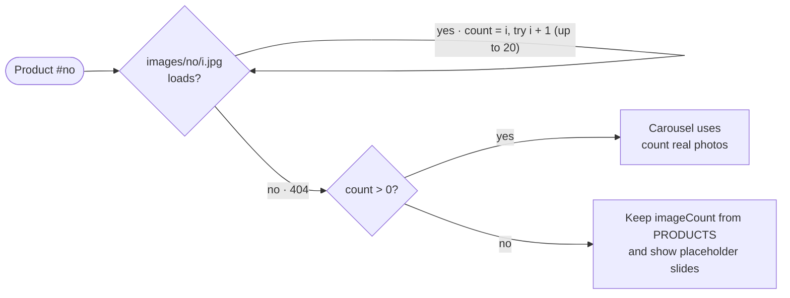

> [!IMPORTANT]
> The site looks for exactly `N.jpg` with a lowercase extension, and Vercel's file names are case-sensitive. A file named `7.Jpg` or `9.png` is not found there, and counting stops at the gap, so every photo after it is skipped too. Mac and Windows file systems ignore case, so this kind of mismatch can look fine locally.

> [!TIP]
> Keep photos around 1200 px on the long side and under about 500 KB each, as [PHOTO-MANIFEST.md](PHOTO-MANIFEST.md) recommends. The catalog appears only after every product's photos have been checked, and each check downloads the full file.

### Add a category

1. Use the new key as the `category` of its products, for example `"glassware"`.
2. Add a filter button to `#categoryFilters` in `index.html`:
   ```html
   <button class="filter-btn" type="button" data-filter="glassware">Glassware</button>
   ```
3. Optionally add a navigation link. `initCategoryNavLinks()` makes it filter the catalog and scroll to it:
   ```html
   <li><a href="#glassware" data-section="glassware">Glassware</a></li>
   ```
4. Add placeholder colours for the key to `CATEGORY_COLORS` in `app.js`. This step is required, because the card renderer reads these colours and the catalog fails to render without them.

### Change the WhatsApp numbers

Numbers are written in international format without `+` or spaces (for example `91XXXXXXXXXX`) and appear in three places:

| Where | What it controls |
|---|---|
| `ORDER_WHATSAPP_NUMBER` in `app.js` | The number that receives cart orders |
| The Quick Order link inside `renderModal()` in `app.js` | The number for single-item Quick Orders, written into the link directly |
| The three `.whatsapp-card` links in the `#order` section of `index.html` | The contact cards under "How to Order" |

### Change the look

All colours, fonts, spacing, corner radii and animation timings are CSS custom properties in the `:root` block of [`styles.css`](styles.css):

<picture>
  <source media="(prefers-color-scheme: dark)" srcset="docs/readme/charts/design-tokens-dark.svg" />
  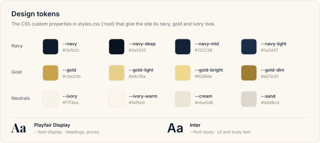
</picture>

| Token group | Values |
|---|---|
| Spacing | `--space-xs` 4 px · `--space-sm` 8 · `--space-md` 16 · `--space-lg` 24 · `--space-xl` 40 · `--space-2xl` 64 · `--space-3xl` 96 |
| Radius | `--radius-sm` 8 px · `--radius-md` 12 · `--radius-lg` 20 · `--radius-xl` 28 · `--radius-full` |
| Motion | `--ease-out` `cubic-bezier(0.16, 1, 0.3, 1)` · `--ease-spring` `cubic-bezier(0.34, 1.56, 0.64, 1)` · 200 / 350 / 600 ms |
| Layout | `--nav-height` 72 px (64 px on small screens) |

## Deployment

The live site at **[the-turning-wheel.vercel.app](https://the-turning-wheel.vercel.app)** is served by Vercel straight from this repository.

- **No build.** Vercel publishes the files in the repository root as they are.
- **Automatic deploys.** The repository is connected to Vercel through its GitHub integration, which publishes a new deployment when changes reach `main`.
- **Analytics.** The two Vercel Web Analytics tags in `<head>` record page views once Analytics is enabled for the project in the Vercel dashboard.

The site runs on any static host, such as Netlify, Cloudflare Pages or GitHub Pages. Outside Vercel, remove the two analytics tags from `index.html`, because `/_vercel/insights/script.js` will not exist.

## Accessibility and browser support

- **Keyboard.** <kbd>Esc</kbd> closes the product modal, the cart and the photo viewer, and <kbd>←</kbd> <kbd>→</kbd> step through photos in the viewer.
- **Screen readers.** The cart, menu, carousel, quantity, zoom and viewer buttons carry `aria-label`s, the cart drawer is a labelled `role="dialog"`, and every product photo has descriptive `alt` text.
- **Reduced motion.** With `prefers-reduced-motion: reduce`, CSS animations and transitions are cut to almost nothing.
- **Touch.** On devices without hover, cards skip the hover lift and give press feedback instead, and carousel arrows stay visible.
- **Browsers.** Current versions of Chrome, Edge, Firefox and Safari on desktop and mobile. The site relies on `IntersectionObserver`, CSS `aspect-ratio`, `backdrop-filter` and Pointer Events.

## Team

The Turning Wheel was designed and built by:

<table>
  <tr>
    <td align="center" width="200">
      <a href="https://github.com/aasthathakkar">
        <br />
        <b>Aastha Thakkar</b>
      </a><br />
      <sub>Co-creator</sub>
    </td>
    <td align="center" width="200">
      <a href="https://github.com/aryanthakkar221-droid">
        <br />
        <b>Aryan Thakkar</b>
      </a><br />
      <sub>Co-creator</sub>
    </td>
  </tr>
</table>

## License

This repository has no open-source license. The code, product photos, logo and brand are © 2026 The Turning Wheel. All rights reserved.

<div align="center">
<br />
<br />
<sub><i>Crafting Change, One Piece at a Time</i></sub>
</div>
